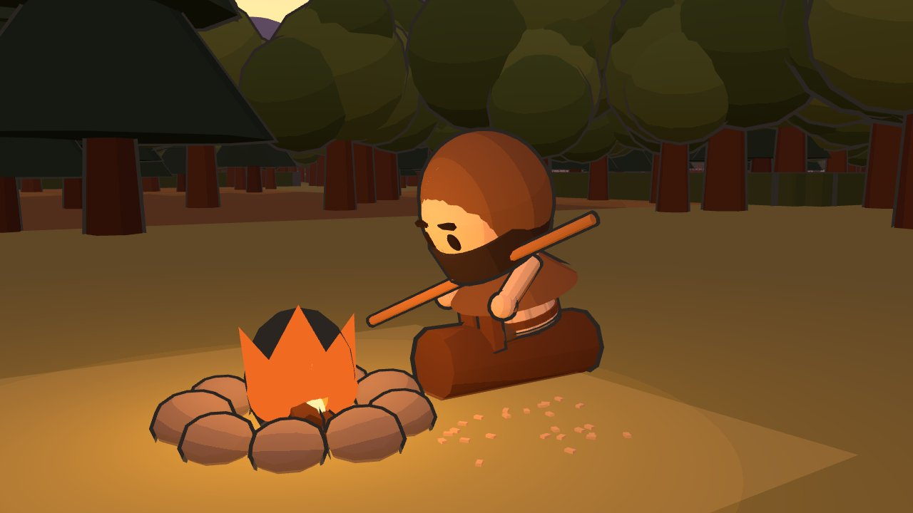
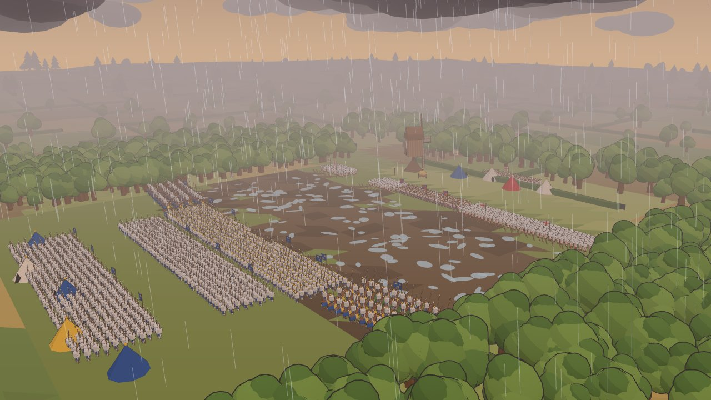
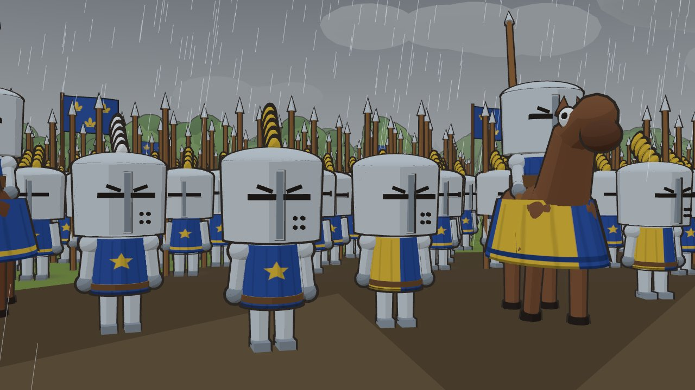
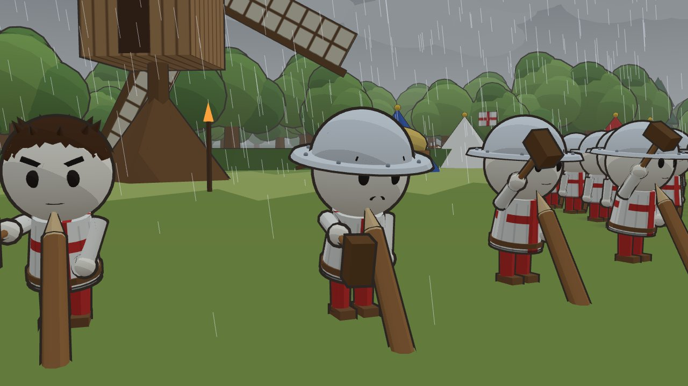
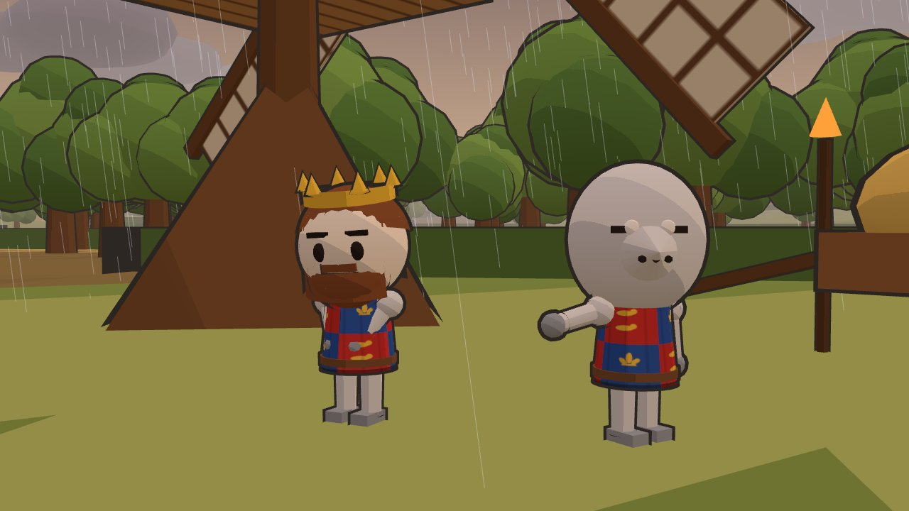
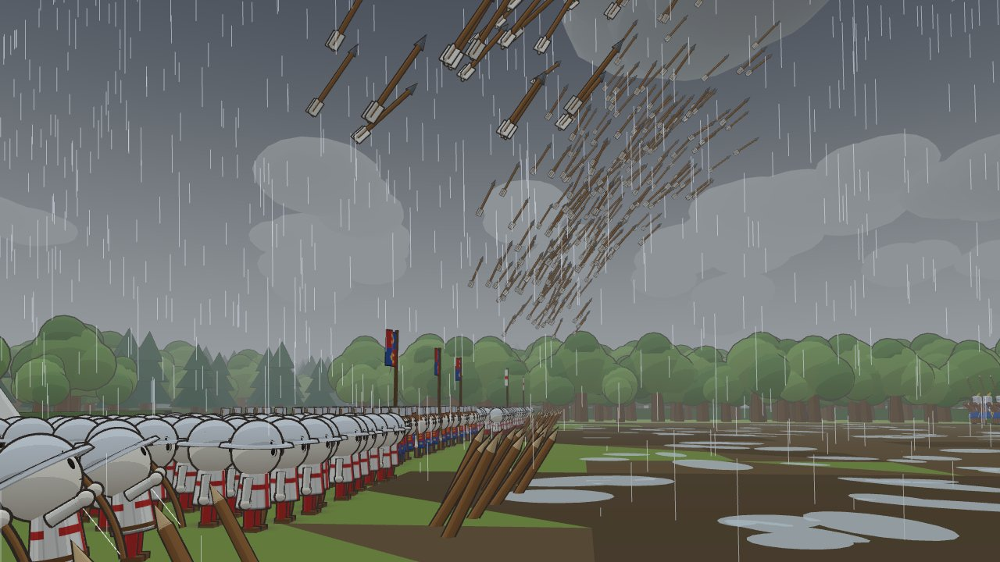

# 3dmap-wartime-visual3dvideo

A cartoon-style 3D battle film made in the browser with Three.js. It uses the look of animated history explainers: chibi soldiers with big heads, cel shading with ink outlines, rain, mud, patchwork fields, a windmill, and thousands of soldiers and arrows.

| | |
|---|---|
|  |  |
|  |  |
|  |  |

## Run it

```bash
npm install
npm run dev
```

Open the URL Vite prints (usually http://localhost:5173).

## Controls

- **Space**: play or pause. **← / →**: previous or next shot. **H**: hide the UI.
- Shot buttons jump to a scene, and the timeline lets you scrub.
- **☔ Rain** turns the rain on or off. **🎥 Free cam** lets you orbit the scene with the mouse.
- **● REC** plays the film from the start and downloads it as `longbow-battle.webm`. Size the window to the resolution you want before you press it. The film is always rendered at 16:9.

URL options: `?shot=3` starts at a given shot, `?t=45` starts at a given second.

## The film (about 71 s)

1. **The Bowyer**: a hooded bowyer carves a stave by a campfire at dusk, with mountains behind.
2. **Two Armies**: a high shot over the rainy fields, the river, the woods and the windmill.
3. **The Knights**: a close-up of knights in great helms with plumes, plus horses in caparisons.
4. **Stakes**: archers hammer sharpened stakes into the ground.
5. **The Plan**: a commander points at the field while the king nods.
6. **Loose!**: the archers draw, and the camera follows the volley into the sky.
7. **Into the Storm**: the French advance through the mud while arrows keep falling.
8. **A Changed World**: a crane shot over the whole battlefield.

## How it's built

| File | What it does |
|---|---|
| `src/toon.js` | Toon gradient, ink outlines, and vertex-colour geometry merging |
| `src/textures.js` | Canvas-painted tabards (St George, royal quarters, French star and pale), banners, sails and planks |
| `src/characters.js` | Close-up hero characters and a horse, built from primitives, with procedural poses (idle, march, trudge, hammer, point, nod, draw, carve, ride) |
| `src/army.js` | `Squad`: formations drawn with `InstancedMesh`, one draw call per body part, with marching and aiming animation |
| `src/volleys.js` | Arrow volleys with arcing paths, computed from time so scrubbing and recording are repeatable |
| `src/world.js` | Terrain, fields, mud and puddles, river, hedges, woods, windmill, camp, sky, clouds, rain, and the lighting moods |
| `src/cast.js` | Where the armies stand and which hero characters each shot uses |
| `src/director.js` | The shot list: camera moves, moods, captions, and volley times |

To make your own scene, edit `SHOTS` in `src/director.js`. Each shot has a camera `from` and `to`, a `mood` (`storm`, `stormDusk` or `dusk`), a caption, and the hero groups to show. Add armies in `buildArmies` and characters with `makeHero({...})` in `src/cast.js`.
